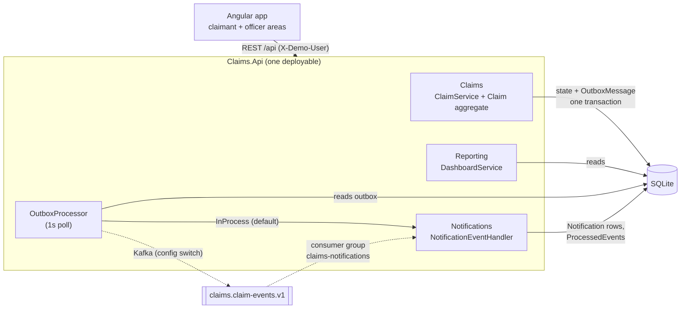

# Architecture & Decisions

## 1. Scope and prioritisation

The brief says to start with the backend and that a strong backend beats a rushed attempt at both tiers. The code reflects that weighting: about 1,940 lines of backend C# plus 510 lines of tests, against about 1,550 lines of Angular (excluding generated migrations), so roughly 60% of the code is backend and tests.

**Built**
- Claim lifecycle with server-enforced state machine, ownership and assignment rules
- Audit history per claim; information request and response loop
- Workload and liability exposure dashboards
- Asynchronous notifications via a transactional outbox, with optional real Kafka
- Problem-details error contract; OpenAPI
- Domain and API integration tests
- Angular app serving both user types

**Deliberately left out** (see section 9)
- Real identity provider
- Document upload
- Email/SMS delivery
- Policy administration and coverage validation
- Reserving rules
- Multi-tenant market permissions
- Real-time push to the browser

## 2. Domain model

```
Claim (aggregate root)
 ├── InformationRequest*   question from officer → answer from claimant
 ├── ClaimHistoryEntry*    append-only audit: who, what, from→to status, note
 └── emits IClaimEvent     ClaimSubmitted, ClaimAssigned, InformationRequested,
                           InformationProvided, ClaimApproved, ClaimRejected, ClaimSettled
Notification              per-recipient message, produced from events
OutboxMessage             event waiting to be published
ProcessedEvent            (eventId, consumer) for idempotent consumers
```

**Lifecycle**, enforced in `Claim` and not in controllers or the UI:

```
Submitted ──pick up──▶ UnderReview ──approve──▶ Approved ──settle──▶ Settled
                         │   ▲  └──reject──▶ Rejected
              request info│   │claimant responds
                         ▼   │
                   InformationRequired ──reject──▶ Rejected
```

**Rules**
- Only the owning claimant can respond to a request.
- Only an officer can pick up a *Submitted* claim, and only the **assigned** officer can action it.
- A rejection needs a reason.
- A settlement can't exceed the approved amount.
- Rejecting a claim closes any open information request.
- Every transition writes a history entry and raises an event, all in one place.

`Claim.AllowedActions(user)` is returned with every claim detail, so the UI renders only valid buttons without duplicating the rules. The API still validates every command.

The six markets (SG, AU, HK, MY, TH, NZ) with their currencies are static reference data. The brief doesn't name them, so this list is an assumption.

## 3. Service boundaries: modular monolith

One deployable ASP.NET Core service with clear modules:



Dotted lines are the Kafka path, which is configured but has not been run against a broker (see §4).

| Module | Responsibility | Code |
|---|---|---|
| Claims | lifecycle commands and queries | `Domain/`, `Services/ClaimService.cs`, `ClaimsController` |
| Reporting | workload and exposure | `Services/DashboardService.cs`, `DashboardController` |
| Notifications | event consumer and inbox | `Services/NotificationService.cs` |
| Platform | persistence, outbox/messaging, auth, errors | `Infrastructure/` |

**Why not microservices now:**
- The boundaries are still being learned.
- There is one team, and the time box is tight.
- Splitting would add distributed transactions, contract versioning and ops overhead with no benefit at this scale.

The modules already talk through **events** where it matters: Notifications never calls Claims, and Reporting could become a projection fed by events. That makes extraction a deployment change, not a rewrite. Triggers to split: different scaling profiles (reporting reads), separate team ownership, or different release cadence.

## 4. REST vs Kafka

| Interaction | Transport | Why |
|---|---|---|
| Submit claim, pick up, request info, respond, approve, reject, settle | **REST** (sync) | The user needs an immediate, authoritative answer (validation errors, conflicts, the new state). |
| Claim detail, lists, dashboards, notifications inbox | **REST** (sync) | Interactive queries. |
| "Something happened to a claim" → notify claimant/officer | **Events** (async) | The user shouldn't wait for it, and it must not fail the business transaction. Fan-out to many consumers. |
| Future: audit/analytics projections, payments, fraud scoring, document processing, downstream core systems | **Kafka** | Decoupled consumers with independent scaling and replay. |

**Delivery guarantees**
- **Transactional outbox:** `ClaimsDbContext.SaveChanges` converts the aggregate's domain events into `OutboxMessage` rows *in the same transaction* as the state change. There is no dual write: an event is never lost for a committed change and never published for a rolled-back one.
- `OutboxProcessor` (background, 1s poll) publishes in `OccurredAt` order and stops a batch on failure so it doesn't reorder events.
- **Transport is configuration:** `Messaging:Transport = InProcess` (default, zero infrastructure) or `Kafka`. With Kafka, events go to `claims.claim-events.v1`, **keyed by ClaimId** so each claim's events stay ordered on one partition. The producer runs with idempotence and `acks=all`. A consumer group (`claims-notifications`) runs the same handlers.
- **At-least-once delivery, idempotent consumers:** handlers record `(EventId, Consumer)` in `ProcessedEvents` and skip duplicates.
- Kafka is optional rather than required because Docker isn't installed on the development machine, and the brief requires something that "can be started locally". `docker-compose.kafka.yml` gives the panel the real broker path.
- **Verification status:** the in-process transport, the outbox and the idempotent handler are covered by tests. The Kafka producer and consumer compile and are wired by configuration, but **have not been run against a real broker**, and no test covers them. The first next step is a Testcontainers integration test.

**Async on the frontend.** Claim progress happens when the *other* party acts, so:
- The UI polls: the notification count every 10s, and an open claim every 10s.
- Command responses return the updated claim, so the acting user sees the change immediately.
- Next step would be SSE/SignalR pushes driven by the same events.

## 5. Frontend: one app, two user types

- **Role-based feature areas.** Claimant (`/claims`, `/claims/new`) and officer (`/officer/queue`, `/officer/dashboard`) areas are lazy-loaded and guarded with `canMatch` role guards. Claimant code is never loaded for an officer, and vice versa.
- **Shared screens where the job is shared.** Claim detail (`/claims/:id`) is one component for both roles. What each user can *do* comes from the server's `allowedActions`. Notifications are shared too.
- **Thin client.**
  - `ApiService` is a typed HTTP client.
  - `SessionService` holds the demo identity, sent by an interceptor as `X-Demo-User`.
  - Components use signals and RxJS, with no state library; the app is small enough not to need one.
- **Guards are UX only.** Security is enforced by the API: every endpoint has `[Authorize(Roles=…)]`, ownership checks and assignment checks.

## 6. Contract between frontend and backend

The **backend owns the contract**:
- C# records in `Contracts/Contracts.cs`, published as OpenAPI (`/swagger`).
- `frontend/claims-ui/src/app/core/models.ts` mirrors it by hand today. Next step: generate it from OpenAPI in CI, so drift fails the build.

Conventions:
- Enums are serialised as strings.
- Times are UTC ISO-8601.
- Errors are RFC 7807 problem details with a machine-readable `code`: `validation_failed`, `forbidden`, `not_found`, `invalid_state`, `concurrency_conflict`.
- Lifecycle changes are explicit command endpoints (`POST /claims/{id}/approve`) rather than `PATCH status`, so each has its own payload, validation and audit entry.

| Method | Path | Role |
|---|---|---|
| GET | `/api/claims?status&open&assigned=me\|unassigned&market&search&sort&page&pageSize` | both (claimant: own only) |
| GET | `/api/claims/{id}` | owner / officer |
| POST | `/api/claims` | claimant |
| POST | `/api/claims/{id}/assign` | officer |
| POST | `/api/claims/{id}/information-requests` | assigned officer |
| POST | `/api/claims/{id}/information-requests/{requestId}/response` | owning claimant |
| POST | `/api/claims/{id}/approve` · `/reject` · `/settle` | assigned officer |
| GET | `/api/dashboard/workload` · `/api/dashboard/exposure` | officer |
| GET/POST | `/api/notifications` · `/{id}/read` · `/read-all` | both |
| GET | `/api/me` · `/api/demo-users` · `/api/reference-data` | — |

## 7. What an officer needs to manage workload

`GET /api/dashboard/workload` and the queue screen provide:
- An unassigned queue, oldest first.
- Open claims by status.
- Ageing buckets, and **SLA breaches** (open for more than `Dashboard:SlaDays`, default 14).
- Per-officer counts: open, under review, waiting on the claimant, waiting for payment.
- Decisions and settlements in the last 30 days, and average days to decision.
- The oldest unassigned claims.

The queue's "awaiting claimant" flag separates work the officer can do now from work that's blocked.

## 8. Liability exposure

Per claim, `Claim.OutstandingLiability` is:
- **the approved amount** for Approved claims that aren't paid yet (committed);
- **the claimant's estimate** for undecided open claims (Submitted, UnderReview, InformationRequired; an indicative reserve);
- **0** for Settled and Rejected claims.

`GET /api/dashboard/exposure` breaks this down by market (local currency and USD), by claim type, approved vs undecided, settled in the last 30 days, and the largest open exposures. FX rates are static and indicative (`Fx:Rates` in appsettings).

**Production would need:**
- Case reserves set by adjusters (not claimant estimates)
- Policy excess, limits and coverage
- Recoveries and salvage
- IBNR handled at portfolio level
- Dated FX rates from a market-data source
- Finance-agreed definitions

The response includes a `basis` string so the number is never shown without its definition.

## 9. Security, data and operations

**Current state**
- Demo header authentication produces a normal `ClaimsPrincipal`; swapping to JWT bearer (OIDC) is a registration change.
- Claimant identity comes from the principal, never from the request body.
- Asking for another claimant's claim returns 404, not 403, so claim ids can't be probed.
- Optimistic concurrency uses a `Version` token, and a race returns 409 `concurrency_conflict`.

**Next steps, in rough priority order**
1. Prove the Kafka path: run the compose broker, add a Testcontainers integration test for producer and consumer, add a dead-letter topic for poison messages (today they are logged and skipped).
2. OIDC (claimants via a customer identity provider, staff via the corporate IdP) and market-scoped officer permissions.
3. Document upload: object storage, malware scan, signed URLs. Information requests are the natural hook.
4. Email/SMS delivery as more event consumers.
5. Read models for reporting, fed from events; SQL Server/Postgres instead of SQLite.
6. Generated TypeScript client from OpenAPI; SSE push instead of polling.
7. Structured logging, tracing (OpenTelemetry), metrics on outbox lag and consumer lag.
8. Reassignment and team-lead approval limits (e.g. approvals above a threshold need a second officer).
9. Data residency and retention per market; PII encryption at rest.
